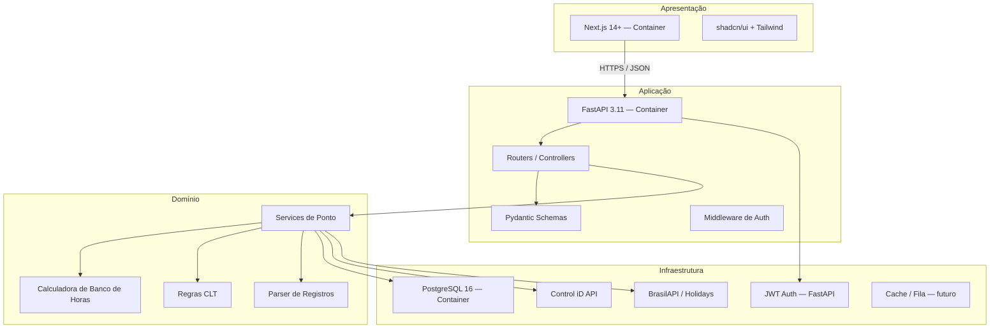
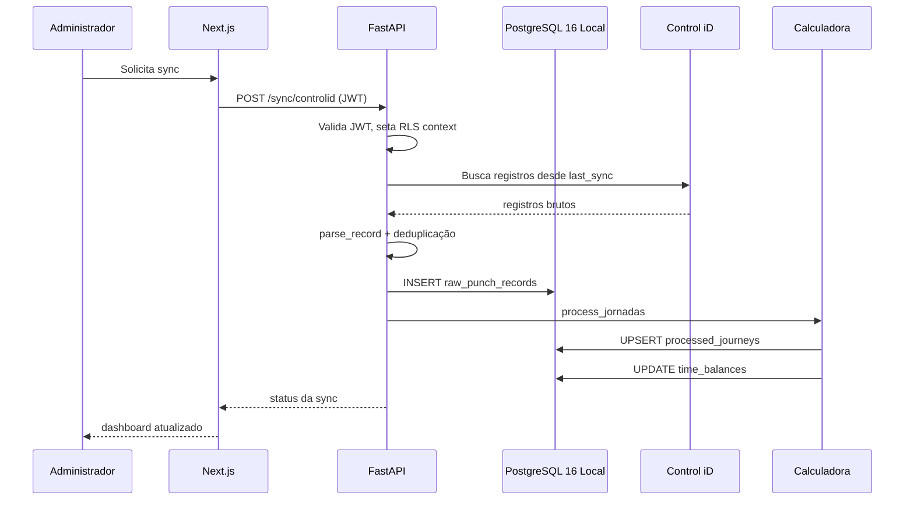
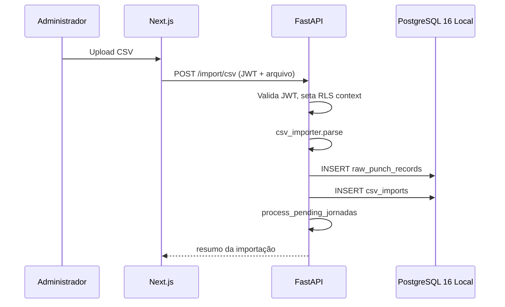
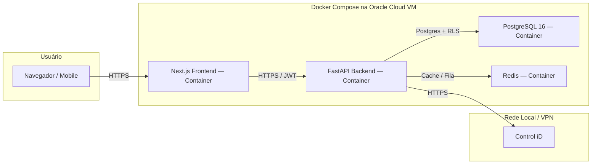

# Arquitetura do Vornia (Workforce Intelligence)

**Projeto:** Vornia — evolução do PontoJa  
**Fase:** 2 — Planejamento da Arquitetura  
**Data:** 2026-11-23 (atualizado para Oracle Cloud Always Free + JWT próprio)

---

## 1. Visão Arquitetural

O Vornia segue uma arquitetura em camadas, com backend em FastAPI, frontend em Next.js, banco de dados PostgreSQL 16 local e autenticação via JWT próprio. Toda a infraestrutura roda em uma única VM **Oracle Cloud Always Free** (ARM, 2 OCPU / 12 GB RAM), orquestrada por Docker Compose, com Caddy fornecendo HTTPS automático. A lógica de domínio é desacoplada do framework web, permitindo reaproveitar regras de negócio maduras do PontoJa.

### Princípios

- **Separação de responsabilidades:** camadas bem definidas (apresentação, aplicação, domínio, infraestrutura).
- **Multi-tenant-ready:** `company_id` em todas as tabelas de negócio desde o início.
- **Segurança em camadas:** JWT + RLS + validação de entrada + rate limiting.
- **Testabilidade:** domínio puro, sem dependência de framework ou banco.
- **Imutabilidade:** nunca mutar objetos; sempre retornar novas instâncias.

---

## 2. Diagrama de Camadas



---

## 3. Fluxo de Dados Principal



### Fluxo de Importação CSV



---

## 4. Decisões Arquiteturais

### ADR 001 — FastAPI + Python

**Decisão:** Usar FastAPI com Python 3.11 no backend.  
**Contexto:** O PontoJa já possui regras de negócio maduras em Python (parser, cálculos, Control iD).  
**Consequências:** Reaproveitamento acelerado; time precisa manter Python; ecossistema de async nativo.

### ADR 002 — Oracle Cloud Always Free + PostgreSQL Local + JWT Próprio

**Decisão:** Hospedar tudo em uma VM Oracle Cloud Always Free (ARM, 2 OCPU / 12 GB RAM), rodando backend, frontend, banco PostgreSQL 16 e Caddy via Docker Compose. Autenticação via JWT próprio no FastAPI.  
**Contexto:** Requisitos de custo zero ($0/mês) e sempre disponível. Render free dorme após inatividade, Supabase free pausa o projeto e Vercel Hobby proíbe uso comercial.  
**Mitigação Idle Reclamation:** A conta Oracle deve ser convertida para **Pay As You Go (PAYG)**. Os recursos Always Free continuam **$0/mês**, mas a política de recuperação por inatividade deixa de se aplicar à VM.  
**Consequências:** Maior controle e zero custo direto; responsabilidade própria de backup, monitoramento e manutenção; cartão necessário para verificação de identidade e eventual cobrança se houver uso fora dos limites Always Free.

### ADR 003 — Next.js em Container Próprio

**Decisão:** Usar Next.js 14+ como frontend, servido como container na mesma VM da Oracle Cloud, via Caddy reverse proxy.  
**Contexto:** Evitar termos de uso não comercial da Vercel Hobby; manter custo zero e controle total.  
**Consequências:** Necessidade de configurar build e servir estáticos/SSR no container; Caddy gerencia HTTPS.

### ADR 004 — Multi-tenant-ready desde o início

**Decisão:** Todas as tabelas de negócio possuem `company_id`; RLS isola por empresa.  
**Contexto:** Permitir evolução para SaaS sem retrabalho.  
**Consequências:** Cada query precisa considerar tenant; índices adicionais em `company_id`.

### ADR 005 — Padrão RLS com JWT Próprio

**Decisão:** FastAPI gera e valida JWT próprio (PyJWT). O backend cria pool no startup; dependency valida o token, abre transação e seta `request.jwt.claims` com JSON achatado (`sub`, `company_id`, `role`).  
**Contexto:** Sem Supabase Auth, o próprio FastAPI é o emissor de tokens. O RLS do PostgreSQL nativo continua isolando dados por tenant.  
**Consequências:** Responsabilidade total sobre segurança dos tokens (secret forte, expiração, refresh, rotação); todas as queries da API rodam dentro de uma transação com contexto setado.

---

## 5. Diagrama de Deploy



---

## 6. Autenticação e Autorização

### JWT Próprio no FastAPI

- O próprio backend FastAPI emite e valida tokens JWT (PyJWT).
- Tabela `users` local no PostgreSQL armazena credenciais (hash bcrypt/Argon2), email, status ativo.
- Tabela `company_users` vincula um usuário a uma empresa com `role`.
- O token JWT contém claims achatadas: `sub` (user_id), `company_id`, `role`, `email`.
- Secret usado para assinar tokens (`JWT_SECRET`) é uma variável de ambiente gerada por ambiente, nunca hardcoded.

### FastAPI Dependency `get_db`

```python
async def get_db(request: Request):
    token = extract_bearer_token(request.headers)
    claims = validate_jwt(token, secret=request.app.state.jwt_secret)

    user_id = claims.get("sub")
    company_id = claims.get("company_id")
    role = claims.get("role", "user")

    if not user_id or not company_id:
        raise HTTPException(status_code=401, detail="Missing context")

    flat_claims = {
        "sub": user_id,
        "company_id": str(company_id),
        "role": role,
    }

    async with request.app.state.db_pool.acquire() as conn:
        async with conn.transaction():
            await conn.execute(
                "SELECT set_config('request.jwt.claims', $1, true)",
                json.dumps(flat_claims),
            )
            yield conn
```

### Roles

| Role | Permissões |
|---|---|
| `owner` | Tudo na empresa |
| `admin` | Gerencia colaboradores, edita pontos, gera relatórios |
| `manager` | Visualiza relatórios, aprova ajustes |
| `user` | Apenas visualiza próprio ponto (futuro portal do colaborador) |

### RLS Policy padrão

> **⚠️ CRÍTICO:** Para que as policies sejam aplicadas, cada tabela de negócio deve ter o RLS explicitamente habilitado com `ALTER TABLE ... ENABLE ROW LEVEL SECURITY;`. Sem isso, as policies existem mas não são aplicadas, permitindo vazamento de dados entre tenants.

```sql
ALTER TABLE processed_journeys ENABLE ROW LEVEL SECURITY;

CREATE POLICY "isolation_by_company" ON processed_journeys
FOR ALL
TO authenticated
USING (
    company_id = (current_setting('request.jwt.claims', true)::jsonb ->> 'company_id')::uuid
);
```

---

## 6.1. Mitigação da Política de Idle Reclamation (Oracle Cloud)

A Oracle Cloud Always Free pode recuperar (apagar) instâncias que permaneçam com **CPU, rede e memória abaixo de 20% por 7 dias consecutivos**. Para um sistema interno de baixo tráfego, isso é um risco real.

### Solução adotada

**Upgrade da conta para Pay As You Go (PAYG).**

- Os recursos **Always Free continuam sem custo** ($0/mês) quando dentro dos limites.
- A política de **Idle Reclamation deixa de se aplicar** às instâncias PAYG/Always Free associadas.
- Não há cobrança automática: só gasta se explicitamente provisionar recursos pagos.

### Checklist obrigatório antes do deploy em produção

- [ ] Conta Oracle convertida para PAYG.
- [ ] Alertas de billing configurados na Oracle (threshold $0 ou $1).
- [ ] Monitoramento de uptime externo (ex.: UptimeRobot free) apontando para o health check.
- [ ] Backup automático do banco configurado, mesmo com PAYG.

### Alternativa documentada (não adotada como principal)

Se por algum motivo o PAYG não for viável, a alternativa é um processo de **keep-alive** (cron a cada 6h fazendo `curl` no `/health` com carga mínima). No entanto, isso não é garantia absoluta e adiciona complexidade operacional.

---

## 7. Estratégia de Multi-tenancy

### Fase MVP — Single-tenant na UI

- Cada instância de deploy gerencia uma única empresa visualmente.
- O schema já é multi-tenant (`company_id` em todas as tabelas).
- RLS garante isolamento desde o início.

### Fase Pós-MVP — Multi-tenant na UI

- Tela de seleção de empresa.
- Um usuário pode pertencer a múltiplas `company_users`.
- A API retorna apenas dados da empresa ativa.

---

## 8. Integrações Externas

| Integração | Tipo | Responsabilidade |
|---|---|---|
| Control iD | HTTPS / JSON | Sincronização de colaboradores, batidas e fotos |
| BrasilAPI | HTTPS / JSON | Feriados nacionais |
| holidays (lib) | Biblioteca Python | Feriados offline |
| BCB / IBGE | HTTPS / JSON | Salário mínimo vigente |
| Local Storage (futuro) | Filesystem / volume Docker | Fotos dos colaboradores |

---

## 9. Observabilidade

- **Logs estruturados:** JSON com `request_id`, `user_id`, `company_id`, `path`.
- **Health check:** endpoint `/health` verifica conexão com banco.
- **Métricas:** tempo de sync, taxa de erro, registros processados.
- **Alertas:** falhas de sync, erros de cálculo, tentativas de login.

---

## 10. Considerações de Performance

- Pool de conexões PostgreSQL (min 5, max 20).
- Índices em `company_id`, `employee_id`, `date`, `status`.
- Processamento de jornadas em batches.
- Upload de fotos assíncrono.
- Exportações com limite de registros e processamento em background (futuro).

---

**Próximo passo:** `docs/SCHEMA-VORNIA.md` — modelagem das entidades e policies RLS.
