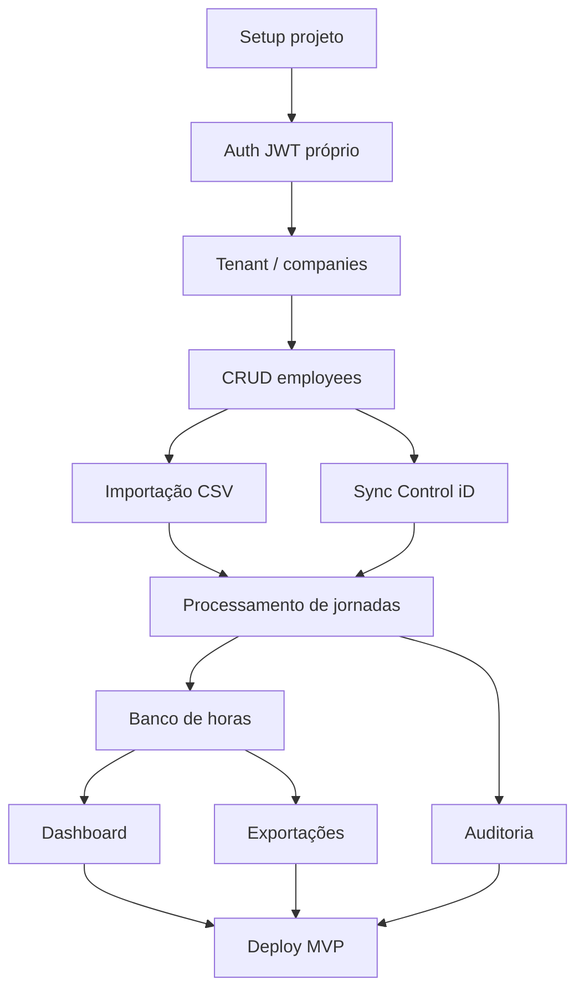

# Planejamento do Vornia (Workforce Intelligence)

**Projeto:** Vornia — evolução do PontoJa  
**Fase:** 2 — Planejamento da Arquitetura e Escopo  
**Data:** 2026-11-23 (atualizado para Oracle Cloud Always Free + JWT próprio)  
**Decisões aprovadas:**
- Backend: FastAPI + Python 3.11
- Banco: PostgreSQL 16 local (container Docker)
- Auth: JWT próprio no FastAPI (sem Supabase Auth, sem Clerk)
- Frontend: Next.js 14+
- Hospedagem: Oracle Cloud Always Free VM ARM (2 OCPU / 12 GB RAM), Ubuntu 22.04, Docker Compose, Caddy (HTTPS automático)
- Tenancy: multi-tenant-ready (company_id em todas as tabelas), UI single-tenant no MVP
- Migração: cadastros + saldos do SQLite legado; histórico completo após 30 dias

---

## 1. Visão Geral

O Vornia é um sistema de **Workforce Intelligence** para gestão de ponto eletrônico, jornadas, banco de horas e conformidade CLT. Ele substitui o PontoJa, corrigindo defeitos lógicos, eliminando riscos de segurança e preparando a base para evoluir como produto SaaS multi-cliente.

### Objetivos do MVP

1. Autenticação segura via JWT próprio no FastAPI.
2. Cadastro de empresa e colaboradores.
3. Importação de registros de ponto via CSV.
4. Sincronização com relógios Control iD.
5. Processamento automático de jornadas diárias.
6. Cálculo de banco de horas e saldos.
7. Dashboard com métricas essenciais.
8. Exportação de relatórios (Excel/PDF).
9. Auditoria de edições manuais.

---

## 2. Fases do Projeto

| Fase | Nome | Status | Entregáveis |
|---|---|---|---|
| 0 | Setup e ECC | ✅ Concluída | ECC instalado, configuração OpenCode, guia de uso |
| 1 | Diagnóstico do PontoJa | ✅ Concluída | `docs/DIAGNOSTICO.md` |
| 2 | Planejamento da Arquitetura | 🔄 Ativa | 6 docs de planejamento |
| 3 | Setup do Projeto + Auth | ⏳ Pendente | Repositório, CI/CD, login, tenant |
| 4 | Domínio de Ponto + Sync | ⏳ Pendente | Employees, importação, Control iD, jornadas |
| 5 | Banco de Horas + Relatórios | ⏳ Pendente | Cálculos, exportações, dashboard |
| 6 | Migração de Dados | ⏳ Pendente | Script de migração do SQLite |
| 7 | Hardening e Deploy | ⏳ Pendente | Segurança, performance, produção |

---

## 3. Escopo do MVP vs Pós-MVP

### MVP (lançamento inicial)

- Login com JWT próprio no FastAPI.
- CRUD de empresa e colaboradores.
- Importação CSV de batidas.
- Sincronização manual com Control iD.
- Processamento de jornadas diárias.
- Cálculo de banco de horas (mês atual).
- Dashboard com resumo do dia.
- Exportação Excel de jornadas.
- Auditoria básica de edições manuais.

### Pós-MVP

- Sincronização automática agendada.
- Aplicativo mobile para colaboradores.
- Relatórios avançados e folha de pagamento.
- Notificações e alertas CLT.
- Multi-tenant na UI (gestão de múltiplas empresas).
- API pública/documentada.
- Integração com AD/SSO.
- Histórico completo de jornadas migrado.

---

## 4. Definition of Done (Critérios de Pronto)

Cada funcionalidade só é considerada pronta quando:

1. **Testes escritos primeiro (TDD)** — testes unitários + integração.
2. **Cobertura mínima de 80%** no código novo/alterado.
3. **Code review** realizado (via agente ECC ou peer review).
4. **Security review** para endpoints, inputs e secrets.
5. **Type hints** e docstrings em funções públicas.
6. **Sem `console.log`/`print`** de debug.
7. **Sem mutação** de objetos (immutability).
8. **Pipeline de CI/CD** passando (testes, lint, type check, segurança).
9. **Documentação atualizada** (schema, API, decision log).

---

## 5. Defeitos do PontoJa — MVP vs Pós-MVP

### Críticos — Corrigir no MVP

| # | Defeito | Arquivo | Ação no Vornia |
|---|---|---|---|
| 1 | Recálculo em ajuste manual usa valor antigo | `routes/admin.py` | Reprocessar com dados atualizados na mesma transação |
| 2 | Sincronização incremental não é incremental | `services/sync_service.py` | Usar `last_sync` real na API do Control iD |
| 3 | `sync_users` pode desativar todos | `services/sync_service.py` | Validar integridade da lista antes de desativar |
| 4 | `resolve_user_id` armazena IDs inexistentes | `services/sync_service.py` | Rejeitar registros sem employee correspondente |
| 5 | TypeError em fusos horários | `services/data_processor.py` | Usar timezone-aware datetimes em todo o pipeline |

### Alto — Corrigir no MVP

| # | Defeito | Ação no Vornia |
|---|---|---|
| 6 | Exceções genéricas silenciam falhas | Logging estruturado e métricas de falha |
| 7 | Fallback de inserção em lote perde registros | Transações com retry e dead-letter |
| 8 | Feriado com jornada especial calcula errado | Unificar base de horas esperadas |
| 9 | Excesso de sábado pode ser pago duas vezes | Descontar excesso antes do payroll |
| 10 | Cálculo noturno impreciso | Recalcular por minuto real |
| 11 | SQL injection via f-string | Queries parametrizadas, sem interpolação |
| 12 | Edições manuais sem validação de hora | Schema Pydantic com validação |
| 13 | Recálculo após commit | Transação atômica edição + reprocessamento |
| 14 | `full_sync` ignora imagens | Respeitar flag `SYNC_INCLUDE_IMAGES` |
| 15 | Senhas admin hardcoded | JWT próprio + hashes fortes, sem defaults |

### Médio — MVP ou Pós-MVP

| # | Defeito | Prioridade |
|---|---|---|
| 16 | Inferência de almoço inventa intervalo | MVP — afeta cálculo de horas |
| 17 | Primeira batida após corte vira saída almoço | MVP |
| 18 | 4+ batidas assumem padrão rígido | Pós-MVP — melhoria de UX |
| 19 | Heurística de 3 batidas confunde volta tarde | MVP |
| 20 | Normalização de timezone com `replace` | MVP |
| 21 | `hours_diff` assume virada de dia | MVP |
| 22 | Chave `saldo_liquido` duplicada | MVP — corrige retorno |
| 23 | Dias futuros marcados como falta | MVP |
| 24 | Exportação PDF sem limite | MVP — adicionar paginação/limite |
| 25 | `exportar_folha` sem período completo | MVP |
| 26 | Race condition em `clear_running_if_stale` | MVP — usar lock real |
| 27 | `login_required` expõe traceback | MVP — mensagens genéricas |
| 28 | `/sincronizacao/testar` sem proteção | MVP — rate limiting + auth |
| 29 | `verificar_faltas` sem validação de data | MVP |
| 30 | `page` inválido causa 500 | MVP |
| 31 | Status analyzer ignora dia em andamento | MVP |
| 32 | `parse_timedelta_str` ignora microssegundos | Pós-MVP |

### Baixo — Pós-MVP

| # | Defeito | Prioridade |
|---|---|---|
| 33 | `registros_intermediarios` arbitrário | Pós-MVP |
| 34 | Configurações de almoço de fontes diferentes | MVP — unificar settings |
| 35 | `ajustar_ponto` permite valor vazio | MVP |
| 36 | `usuario` não sanitizado para LIKE | MVP |
| 37 | `datetime.strptime` redundante | Pós-MVP |
| 38 | `sync_images` sem log de falha | MVP |
| 39 | `except:` vazio | MVP |
| 40 | Assinaturas sem `Optional` | Pós-MVP |

---

## 5.1 Mapeamento dos 40 Defeitos para Sprints

| # | Defeito | Sprint | Status |
|---|---|---|---|
| 1 | Recálculo em ajuste manual usa valor antigo | Sprint 6 | Corrige no MVP |
| 2 | Sincronização incremental não é incremental | Sprint 3 | Corrige no MVP |
| 3 | `sync_users` pode desativar todos | Sprint 3 | Corrige no MVP |
| 4 | `resolve_user_id` armazena IDs inexistentes | Sprint 3 | Corrige no MVP |
| 5 | TypeError em fusos horários | Sprint 3 | Corrige no MVP |
| 6 | Exceções genéricas silenciam falhas | Sprint 3 | Corrige no MVP |
| 7 | Fallback de inserção em lote perde registros | Sprint 3 | Corrige no MVP |
| 8 | Feriado com jornada especial calcula errado | Sprint 4 | Corrige no MVP |
| 9 | Excesso de sábado pode ser pago duas vezes | Sprint 4 | Corrige no MVP |
| 10 | Cálculo noturno impreciso | Sprint 4 | Corrige no MVP |
| 11 | SQL injection via f-string | Sprint 6 | Corrige no MVP |
| 12 | Edições manuais sem validação de hora | Sprint 6 | Corrige no MVP |
| 13 | Recálculo após commit | Sprint 6 | Corrige no MVP |
| 14 | `full_sync` ignora imagens | Sprint 3 | Corrige no MVP |
| 15 | Senhas admin hardcoded | Sprint 1 | Corrige no MVP |
| 16 | Inferência de almoço inventa intervalo | Sprint 4 | Corrige no MVP |
| 17 | Primeira batida após corte vira saída almoço | Sprint 4 | Corrige no MVP |
| 18 | 4+ batidas assumem padrão rígido | Sprint 7 | Pós-MVP |
| 19 | Heurística de 3 batidas confunde volta tarde | Sprint 4 | Corrige no MVP |
| 20 | Normalização de timezone com `replace` | Sprint 3 | Corrige no MVP |
| 21 | `hours_diff` assume virada de dia | Sprint 4 | Corrige no MVP |
| 22 | Chave `saldo_liquido` duplicada | Sprint 4 | Corrige no MVP |
| 23 | Dias futuros marcados como falta | Sprint 4 | Corrige no MVP |
| 24 | Exportação PDF sem limite | Sprint 5 | Corrige no MVP |
| 25 | `exportar_folha` sem período completo | Sprint 5 | Corrige no MVP |
| 26 | Race condition em `clear_running_if_stale` | Sprint 3 | Corrige no MVP |
| 27 | `login_required` expõe traceback | Sprint 1 | Corrige no MVP |
| 28 | `/sincronizacao/testar` sem proteção | Sprint 3 | Corrige no MVP |
| 29 | `verificar_faltas` sem validação de data | Sprint 2 | Corrige no MVP |
| 30 | `page` inválido causa 500 | Sprint 2 | Corrige no MVP |
| 31 | Status analyzer ignora dia em andamento | Sprint 4 | Corrige no MVP |
| 32 | `parse_timedelta_str` ignora microssegundos | Sprint 7 | Pós-MVP |
| 33 | `registros_intermediarios` arbitrário | Sprint 7 | Pós-MVP |
| 34 | Configurações de almoço de fontes diferentes | Sprint 2 | Corrige no MVP |
| 35 | `ajustar_ponto` permite valor vazio | Sprint 6 | Corrige no MVP |
| 36 | `usuario` não sanitizado para LIKE | Sprint 5 | Corrige no MVP |
| 37 | `datetime.strptime` redundante | Sprint 7 | Pós-MVP |
| 38 | `sync_images` sem log de falha | Sprint 3 | Corrige no MVP |
| 39 | `except:` vazio | Sprint 3 | Corrige no MVP |
| 40 | Assinaturas sem `Optional` | Sprint 7 | Pós-MVP |

**Garantia:** todos os 5 defeitos críticos e 10 altos entram no MVP (Sprints 1–6). Apenas 6 médios/baixos ficam para pós-MVP (Sprint 7).

---

## 6. Roadmap de Funcionalidades

### Sprint 1 — Fundação
- Setup do monorepo Vornia.
- Configuração CI/CD (GitHub Actions).
- PostgreSQL 16 local via Docker Compose.
- FastAPI + estrutura de camadas.
- Next.js + Tailwind + shadcn/ui.
- JWT próprio + login.

### Sprint 2 — Tenant e Cadastros
- Tabela `companies`.
- Vínculo `company_users`.
- CRUD de `employees`.
- RLS por company_id.

### Sprint 3 — Importação e Sincronização
- Upload CSV de batidas.
- Cliente Control iD portado.
- Sincronização manual de registros.
- Processamento de jornadas.

### Sprint 4 — Cálculos e Dashboard
- Banco de horas calculado.
- Status do dia.
- Dashboard com métricas.

### Sprint 5 — Relatórios e Auditoria
- Exportação Excel.
- Exportação PDF.
- Edição manual com auditoria.

### Sprint 6 — Migração e Deploy
- Script de migração SQLite → PostgreSQL local.
- Deploy em Oracle Cloud Always Free VM (Docker Compose + Caddy).
- Testes E2E críticos.

---

## 7. Riscos e Mitigações

| Risco | Probabilidade | Impacto | Mitigação |
|---|---|---|---|
| Responsabilidade total pelo JWT/auth | Média | Alto | Secret forte, rotação, refresh tokens, backups de hashes; sem lock-in de provider |
| Complexidade do porte de cálculos CLT | Alta | Alto | Testes regressivos fortes antes de alterar lógica |
| Dados inconsistentes na migração | Média | Alto | Migração em duas fases; validação automatizada |
| Performance com RLS em todas as tabelas | Média | Médio | Índices em `company_id`; testar com volume real |
| Sessões/expiração de JWT | Média | Médio | Refresh tokens, validação no backend |
| Dependência do Control iD | Baixa | Alto | Abstrair cliente; suportar múltiplos firmwares |

---

## 8. Dependências entre Tarefas

---

**Próximo passo:** FASE 3 — Setup do projeto, autenticação e tenant.
