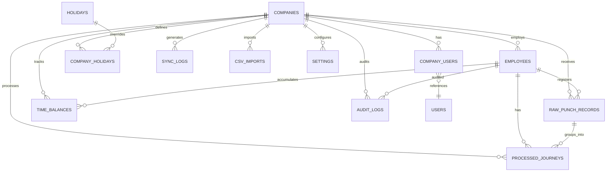

# Schema de Dados do Vornia

**Projeto:** Vornia — Workforce Intelligence  
**Banco:** PostgreSQL 16 local (container Docker na Oracle Cloud Always Free VM)  
**Tenancy:** Multi-tenant-ready com RLS por `company_id`  
**Data:** 2026-11-23 (atualizado: `users` local, sem `auth.users`)

---

## 1. Introdução

Este documento define o schema relacional do Vornia. Todas as tabelas de negócio possuem `company_id` como chave de tenant. O isolamento é garantido por RLS policies que leem `company_id` do contexto JWT propagado pelo FastAPI.

### Convenções

- IDs são `uuid` gerados por `gen_random_uuid()`.
- Timestamps: `created_at`, `updated_at` em todas as tabelas.
- Soft delete: `deleted_at` opcional (futuro); por ora, exclusão lógica via `is_active`.
- Nomeação: snake_case, tabelas no plural.

---

## 2. ERD — Diagrama Entidade-Relacionamento



---

## 3. Tabelas

### 3.1 `companies`

Empresas/tenants do sistema.

| Coluna | Tipo | Constraints | Descrição |
|---|---|---|---|
| `id` | uuid | PK, default gen_random_uuid() | Identificador da empresa |
| `name` | text | NOT NULL | Razão social ou nome fantasia |
| `document` | text | UNIQUE | CNPJ/CPF |
| `trade_name` | text | | Nome fantasia |
| `timezone` | text | NOT NULL, default 'America/Sao_Paulo' | Fuso horário |
| `is_active` | boolean | NOT NULL, default true | Empresa ativa |
| `created_at` | timestamptz | NOT NULL, default now() | Criação |
| `updated_at` | timestamptz | NOT NULL, default now() | Atualização |

**RLS:**
```sql
ALTER TABLE companies ENABLE ROW LEVEL SECURITY;

CREATE POLICY "companies_isolation" ON companies
FOR ALL
TO authenticated
USING (id = (current_setting('request.jwt.claims', true)::jsonb ->> 'company_id')::uuid);
```

---

### 3.2 `users`

Usuários locais do sistema. O FastAPI emite e valida JWTs com base nesta tabela.

| Coluna | Tipo | Constraints | Descrição |
|---|---|---|---|
| `id` | uuid | PK, default gen_random_uuid() | Identificador do usuário |
| `email` | text | NOT NULL, UNIQUE | E-mail de login |
| `password_hash` | text | NOT NULL | Hash da senha (bcrypt/Argon2) |
| `full_name` | text | | Nome completo |
| `is_active` | boolean | NOT NULL, default true | Usuário ativo |
| `email_verified` | boolean | NOT NULL, default false | E-mail confirmado |
| `created_at` | timestamptz | NOT NULL, default now() | Criação |
| `updated_at` | timestamptz | NOT NULL, default now() | Atualização |

**RLS:**

```sql
ALTER TABLE users ENABLE ROW LEVEL SECURITY;

CREATE POLICY "users_self_access" ON users
FOR ALL
TO authenticated
USING (id = (current_setting('request.jwt.claims', true)::jsonb ->> 'sub')::uuid);
```

> No MVP, a criação do primeiro usuário/owner é feita por script de bootstrap com senha aleatória. A partir daí, convites são emitidos por admins/owner existentes.

---

### 3.3 `company_users`

Vínculo entre usuários locais (`users`) e empresas, com role dentro do tenant.

| Coluna | Tipo | Constraints | Descrição |
|---|---|---|---|
| `id` | uuid | PK | |
| `user_id` | uuid | NOT NULL, FK users(id) | Usuário local |
| `company_id` | uuid | NOT NULL, FK companies(id) | Empresa |
| `role` | text | NOT NULL, check in ('owner','admin','manager','user') | Papel |
| `is_active` | boolean | NOT NULL, default true | |
| `created_at` | timestamptz | NOT NULL, default now() | |
| `updated_at` | timestamptz | NOT NULL, default now() | |

**Índice:** `(user_id, company_id)` UNIQUE.

**RLS:**
```sql
ALTER TABLE company_users ENABLE ROW LEVEL SECURITY;

CREATE POLICY "company_users_isolation" ON company_users
FOR ALL
TO authenticated
USING (company_id = (current_setting('request.jwt.claims', true)::jsonb ->> 'company_id')::uuid);
```

---

### 3.4 `employees`

Colaboradores da empresa.

| Coluna | Tipo | Constraints | Descrição |
|---|---|---|---|
| `id` | uuid | PK | |
| `company_id` | uuid | NOT NULL, FK companies(id) | Tenant |
| `control_id` | bigint | | ID no relógio de ponto |
| `name` | text | NOT NULL | Nome |
| `registration` | text | | Matrícula |
| `pis` | text | | PIS/PASEP |
| `cpf` | text | | CPF |
| `job_title` | text | | Cargo |
| `department` | text | | Departamento |
| `work_schedule` | jsonb | | Escala de trabalho |
| `photo_url` | text | | Caminho/URL da foto no storage local |
| `is_active` | boolean | NOT NULL, default true | |
| `hired_at` | date | | Data de admissão |
| `created_at` | timestamptz | NOT NULL, default now() | |
| `updated_at` | timestamptz | NOT NULL, default now() | |

**Índices:** `(company_id, control_id)`, `(company_id, pis)`, `(company_id, is_active)`.

**RLS:**
```sql
ALTER TABLE employees ENABLE ROW LEVEL SECURITY;

CREATE POLICY "employees_isolation" ON employees
FOR ALL
TO authenticated
USING (company_id = (current_setting('request.jwt.claims', true)::jsonb ->> 'company_id')::uuid);
```

---

### 3.5 `raw_punch_records`

Batidas brutas importadas do Control iD ou CSV.

| Coluna | Tipo | Constraints | Descrição |
|---|---|---|---|
| `id` | uuid | PK | |
| `company_id` | uuid | NOT NULL, FK companies(id) | Tenant |
| `employee_id` | uuid | NOT NULL, FK employees(id) | Colaborador |
| `punched_at` | timestamptz | NOT NULL | Data/hora da batida |
| `record_type` | integer | | Tipo do registro (AFD) |
| `raw_data` | text | | Linha/dado bruto |
| `source` | text | NOT NULL, check in ('controlid','csv','manual') | Origem |
| `processed` | boolean | NOT NULL, default false | Se já foi processado |
| `created_at` | timestamptz | NOT NULL, default now() | |

**Índices:** `(company_id, employee_id, punched_at)`, `(company_id, processed)`.

**RLS:**
```sql
ALTER TABLE raw_punch_records ENABLE ROW LEVEL SECURITY;

CREATE POLICY "raw_punch_records_isolation" ON raw_punch_records
FOR ALL
TO authenticated
USING (company_id = (current_setting('request.jwt.claims', true)::jsonb ->> 'company_id')::uuid);
```

---

### 3.6 `processed_journeys`

Jornadas diárias processadas a partir das batidas.

| Coluna | Tipo | Constraints | Descrição |
|---|---|---|---|
| `id` | uuid | PK | |
| `company_id` | uuid | NOT NULL, FK companies(id) | Tenant |
| `employee_id` | uuid | NOT NULL, FK employees(id) | Colaborador |
| `date` | date | NOT NULL | Data da jornada |
| `entry` | time | | Entrada |
| `lunch_exit` | time | | Saída almoço |
| `lunch_return` | time | | Volta almoço |
| `exit` | time | | Saída |
| `worked_hours` | decimal(5,2) | | Horas trabalhadas |
| `expected_hours` | decimal(5,2) | | Horas esperadas |
| `overtime_hours` | decimal(5,2) | | Horas extras |
| `night_hours` | decimal(5,2) | | Horas noturnas |
| `status` | text | NOT NULL | completo, pendente, falta, inconsistencia |
| `notes` | text | | Observações |
| `created_at` | timestamptz | NOT NULL, default now() | |
| `updated_at` | timestamptz | NOT NULL, default now() | |

**Índices:** `(company_id, employee_id, date)` UNIQUE, `(company_id, status)`.

**RLS:**
```sql
ALTER TABLE processed_journeys ENABLE ROW LEVEL SECURITY;

CREATE POLICY "processed_journeys_isolation" ON processed_journeys
FOR ALL
TO authenticated
USING (company_id = (current_setting('request.jwt.claims', true)::jsonb ->> 'company_id')::uuid);
```

---

### 3.7 `time_balances`

Saldos de banco de horas por colaborador e período.

| Coluna | Tipo | Constraints | Descrição |
|---|---|---|---|
| `id` | uuid | PK | |
| `company_id` | uuid | NOT NULL, FK companies(id) | Tenant |
| `employee_id` | uuid | NOT NULL, FK employees(id) | Colaborador |
| `reference_month` | date | NOT NULL | Mês de referência |
| `opening_balance` | decimal(8,2) | NOT NULL | Saldo inicial |
| `earned_hours` | decimal(8,2) | NOT NULL, default 0 | Horas ganhas |
| `owed_hours` | decimal(8,2) | NOT NULL, default 0 | Horas devidas |
| `closing_balance` | decimal(8,2) | NOT NULL | Saldo final |
| `created_at` | timestamptz | NOT NULL, default now() | |
| `updated_at` | timestamptz | NOT NULL, default now() | |

**Índice:** `(company_id, employee_id, reference_month)` UNIQUE.

**RLS:**
```sql
ALTER TABLE time_balances ENABLE ROW LEVEL SECURITY;

CREATE POLICY "time_balances_isolation" ON time_balances
FOR ALL
TO authenticated
USING (company_id = (current_setting('request.jwt.claims', true)::jsonb ->> 'company_id')::uuid);
```

---

### 3.8 `holidays`

Feriados nacionais/estaduais (globais).

| Coluna | Tipo | Constraints | Descrição |
|---|---|---|---|
| `id` | uuid | PK | |
| `date` | date | NOT NULL | Data |
| `name` | text | NOT NULL | Nome |
| `type` | text | NOT NULL | nacional, estadual, municipal |
| `state` | text | | UF |
| `city` | text | | Município |
| `created_at` | timestamptz | NOT NULL, default now() | |

**Índice:** `(date, state, city)` UNIQUE.

**RLS:** Acesso global via `service_role` ou role específica; usuários autenticados podem ler.

---

### 3.9 `company_holidays`

Feriados e jornadas específicas da empresa.

| Coluna | Tipo | Constraints | Descrição |
|---|---|---|---|
| `id` | uuid | PK | |
| `company_id` | uuid | NOT NULL, FK companies(id) | Tenant |
| `date` | date | NOT NULL | Data |
| `name` | text | NOT NULL | Nome |
| `type` | text | NOT NULL | feriado, ponto_facultativo, jornada_especial |
| `expected_hours` | decimal(4,2) | | Horas esperadas no dia |
| `created_at` | timestamptz | NOT NULL, default now() | |

**Índice:** `(company_id, date)` UNIQUE.

**RLS:**
```sql
ALTER TABLE company_holidays ENABLE ROW LEVEL SECURITY;

CREATE POLICY "company_holidays_isolation" ON company_holidays
FOR ALL
TO authenticated
USING (company_id = (current_setting('request.jwt.claims', true)::jsonb ->> 'company_id')::uuid);
```

---

### 3.10 `sync_logs`

Logs de sincronização com Control iD.

| Coluna | Tipo | Constraints | Descrição |
|---|---|---|---|
| `id` | uuid | PK | |
| `company_id` | uuid | NOT NULL, FK companies(id) | Tenant |
| `sync_type` | text | NOT NULL | full, incremental, users, images |
| `status` | text | NOT NULL | success, error, running |
| `records_new` | integer | | Registros novos |
| `records_updated` | integer | | Registros atualizados |
| `message` | text | | Mensagem |
| `error` | text | | Erro |
| `started_at` | timestamptz | NOT NULL | Início |
| `finished_at` | timestamptz | | Fim |
| `created_at` | timestamptz | NOT NULL, default now() | |

**RLS:**
```sql
ALTER TABLE sync_logs ENABLE ROW LEVEL SECURITY;

CREATE POLICY "sync_logs_isolation" ON sync_logs
FOR ALL
TO authenticated
USING (company_id = (current_setting('request.jwt.claims', true)::jsonb ->> 'company_id')::uuid);
```

---

### 3.11 `audit_logs`

Auditoria imutável de edições manuais.

| Coluna | Tipo | Constraints | Descrição |
|---|---|---|---|
| `id` | uuid | PK | |
| `company_id` | uuid | NOT NULL, FK companies(id) | Tenant |
| `employee_id` | uuid | NOT NULL, FK employees(id) | Colaborador afetado |
| `table_name` | text | NOT NULL | Tabela alterada |
| `record_id` | uuid | NOT NULL | ID do registro alterado |
| `action` | text | NOT NULL | insert, update, delete |
| `old_values` | jsonb | | Valores antigos |
| `new_values` | jsonb | | Valores novos |
| `changed_by` | uuid | NOT NULL | ID do usuário que alterou |
| `reason` | text | | Motivo |
| `ip_address` | text | | IP do usuário |
| `created_at` | timestamptz | NOT NULL, default now() | |

**RLS:**
```sql
ALTER TABLE audit_logs ENABLE ROW LEVEL SECURITY;

CREATE POLICY "audit_logs_isolation" ON audit_logs
FOR ALL
TO authenticated
USING (company_id = (current_setting('request.jwt.claims', true)::jsonb ->> 'company_id')::uuid);
```

---

### 3.12 `csv_imports`

Histórico de importações CSV.

| Coluna | Tipo | Constraints | Descrição |
|---|---|---|---|
| `id` | uuid | PK | |
| `company_id` | uuid | NOT NULL, FK companies(id) | Tenant |
| `filename` | text | NOT NULL | Nome do arquivo |
| `records_imported` | integer | | Registros importados |
| `records_failed` | integer | | Registros com falha |
| `status` | text | NOT NULL | success, partial, error |
| `errors` | jsonb | | Detalhes de erros |
| `imported_by` | uuid | NOT NULL | Usuário |
| `created_at` | timestamptz | NOT NULL, default now() | |

**RLS:**
```sql
ALTER TABLE csv_imports ENABLE ROW LEVEL SECURITY;

CREATE POLICY "csv_imports_isolation" ON csv_imports
FOR ALL
TO authenticated
USING (company_id = (current_setting('request.jwt.claims', true)::jsonb ->> 'company_id')::uuid);
```

---

### 3.13 `settings`

Configurações por empresa (substitui `configuracoes` do PontoJa).

| Coluna | Tipo | Constraints | Descrição |
|---|---|---|---|
| `id` | uuid | PK | |
| `company_id` | uuid | NOT NULL, FK companies(id) | Tenant |
| `key` | text | NOT NULL | Chave |
| `value` | jsonb | NOT NULL | Valor |
| `created_at` | timestamptz | NOT NULL, default now() | |
| `updated_at` | timestamptz | NOT NULL, default now() | |

**Índice:** `(company_id, key)` UNIQUE.

**RLS:**
```sql
ALTER TABLE settings ENABLE ROW LEVEL SECURITY;

CREATE POLICY "settings_isolation" ON settings
FOR ALL
TO authenticated
USING (company_id = (current_setting('request.jwt.claims', true)::jsonb ->> 'company_id')::uuid);
```

---

## 4. Considerações de Segurança Adicionais

### 4.1 RLS — Requisito Crítico

> **⚠️ CRÍTICO:** Sem `ALTER TABLE ... ENABLE ROW LEVEL SECURITY;`, as policies RLS **não são aplicadas** pelo PostgreSQL, e qualquer usuário autenticado com permissão `SELECT` pode ler dados de todos os tenants. Cada tabela de negócio deve ter explicitamente o RLS habilitado antes das policies serem criadas.

As policies deste documento isolam por `company_id`. O controle de acesso baseado em papel (`owner`, `admin`, `manager`, `user`) e a verificação de vínculo ativo (`company_users.is_active = true`, `companies.is_active = true`) são implementados na camada de aplicação (FastAPI). Como defesa em profundura, policies podem evoluir para:

```sql
CREATE POLICY "employees_isolation_strict" ON employees
FOR ALL
TO authenticated
USING (
    company_id = (current_setting('request.jwt.claims', true)::jsonb ->> 'company_id')::uuid
    AND EXISTS (
        SELECT 1 FROM company_users cu
        WHERE cu.user_id = (current_setting('request.jwt.claims', true)::jsonb ->> 'sub')::uuid
          AND cu.company_id = employees.company_id
          AND cu.is_active = true
    )
);
```

No MVP, a validação de `is_active` e roles fica no FastAPI para simplificar as policies.

### 4.2 Fotos de colaboradores (`employees.photo_url`)

As fotos são armazenadas em **storage local** (volume Docker ou filesystem) com acesso controlado pela API. O backend só serve a imagem se o usuário autenticado pertencer ao mesmo `company_id` do colaborador. As URLs temporárias expiram em no máximo 5 minutos.

### 4.3 Tabela `holidays`

A tabela `holidays` é global (sem `company_id`) e contém feriados nacionais/estaduais. O acesso é somente leitura para usuários autenticados e gerenciado por `service_role` ou admin global.

---

## 5. Extensões Necessárias

```sql
CREATE EXTENSION IF NOT EXISTS "uuid-ossp";
CREATE EXTENSION IF NOT EXISTS "pgcrypto";
```

---

## 6. Notas sobre Migração do SQLite Legado

- `usuarios` → `employees` + `companies`.
- `registros_brutos` → `raw_punch_records`.
- `jornadas_processadas` → `processed_journeys`.
- `saldos_usuario` → `time_balances`.
- `configuracoes` → `settings`.
- `feriados` → `holidays` + `company_holidays`.
- `admins` → `users` + `company_users`.
- `ponto_auditoria` / `edicoes_manuais` → `audit_logs`.

Dados históricos de jornadas só serão migrados na fase 2 (após 30 dias do Vornia rodando).

---

**Próximo passo:** `docs/PORTE-SERVICOS.md` — matriz de porte dos serviços do PontoJa.
